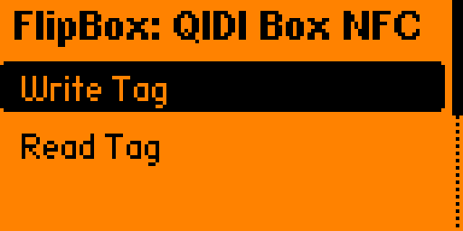
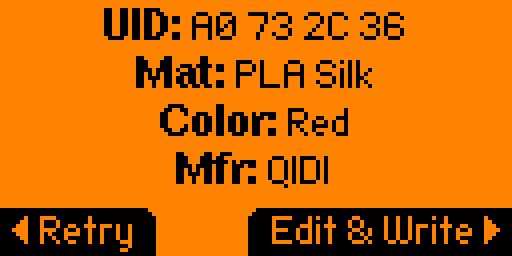
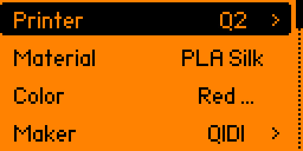
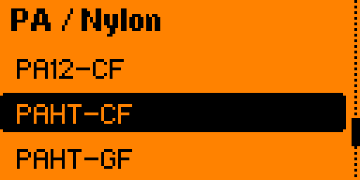
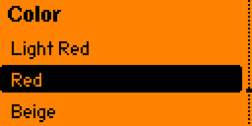

# FlipBox

Flipper Zero app for reading and writing NFC tags used by the [QIDI Box](https://wiki.qidi3d.com/en/QIDIBOX/RFID) filament management system.

## Screenshots

| Menu                             | Read result                                    | Write config                                  |
|----------------------------------|------------------------------------------------|-----------------------------------------------|
|  |  |  |

| Material picker                                        | Color picker                                     | Write success                                      |
|--------------------------------------------------------|--------------------------------------------------|----------------------------------------------------|
|  |  |  |

## What it does

- **Read** — hold the Flipper near a QIDI Box spool tag and see its UID, material, color and
  manufacturer
- **Write** — pick printer / material / color / maker, then write your own tag

The tag stores only numeric codes, and each printer model maps them to names with its own table,
so pick your printer first (`Write Tag → Printer`, left/right). The choice is remembered and also
used to name materials when reading.

Works with any MIFARE Classic 1K spool tag (FM11RF08S or compatible); see [Tags](#tags) for
which blank stickers to buy.

## Compatibility

A Flipper app only loads on firmware with the same API major version, so each release ships one
file per API:

| Firmware                       | API | File                |
|--------------------------------|-----|---------------------|
| Official 1.4.x                 | 87  | `flipbox-api87.fap` |
| Momentum mntm-012              | 87  | `flipbox-api87.fap` |
| Official 1.5.x                 | 88  | `flipbox-api88.fap` |
| Unleashed unlshd-090 and newer | 88  | `flipbox-api88.fap` |
| RogueMaster RM0713 and newer   | 88  | `flipbox-api88.fap` |

If the Flipper says "Update Application" or "Update Firmware", you have the file for the other API.

| Printer | Code table                                                                                  |
|---------|---------------------------------------------------------------------------------------------|
| Q2      | `officiall_filas_list.cfg` from [QIDI_Q2](https://github.com/QIDITECH/QIDI_Q2) V1.1.1       |
| Max4    | `officiall_filas_list.cfg` from [QIDI_MAX4](https://github.com/QIDITECH/QIDI_MAX4)          |
| Plus4   | `officiall_filas_list.cfg` from [QIDI_PLUS4](https://github.com/QIDITECH/QIDI_PLUS4) V1.7.1 |

**Plus5 and Q2C are not supported yet:** both work with the QIDI Box, but QIDI has not published
their filament table (`officiall_filas_list.cfg`), so the code-to-name mapping for them is unknown.
The Q2 or Max4 table may match, but this is unverified.

## Install

Download the `.fap` for your firmware (see [Compatibility](#compatibility)) from [Releases](https://github.com/rmrfus/flipbox/releases) and copy it to `SD:/apps/NFC/` on the Flipper's SD card.

Two ways to copy:

- **qFlipper** — connect Flipper via USB, open [qFlipper](https://flipperzero.one/update), go to SD card browser → `apps/NFC/`, drag the file in
- **USB mass storage** — on the Flipper: `Settings → USB → Mass Storage`, then mount as a flash drive and copy manually

The app will appear in `Apps → NFC → FlipBox`.

## Build from source

Requires [ufbt](https://github.com/flipperdevices/flipperzero-ufbt) and [direnv](https://direnv.net/).

```zsh
git clone https://github.com/rmrfus/flipbox
cd flipbox
direnv allow

# just build → dist/flipbox.fap
direnv exec . ufbt

# or build + deploy + launch over USB serial
direnv exec . ufbt launch
```

`ufbt launch` copies the app to `SD:/apps/NFC/` over USB serial and starts it immediately. The Flipper must be connected, unlocked, and on the main screen.

The SDK defaults to the official release channel. To build for the next API (e.g. Unleashed), switch the channel first:

```zsh
direnv exec . ufbt update --channel=rc
```

## Tags

### Buying tags

Use **MIFARE Classic 1K** stickers. Listings call them "MIFARE Classic 1K", "MF1 S50", "S50",
"M1 1K" or "Fudan F08", with ISO 14443A and 13.56 MHz. Blank tags ship with the factory key
`FF:FF:FF:FF:FF:FF` on every sector. The box reads such tags and FlipBox writes them as they
are, with no formatting.

Known good: BABIQT "MF Classic 1K Tags S50 RFID Stickers", 1 inch (25 mm) round,
self-adhesive, 50 pcs. The listing is gone (2026-10); search for the same description.

These do **not** work, even when sold as "NFC tags":

| Listing says                                    | What it is                   | Why it fails                                                |
|-------------------------------------------------|------------------------------|-------------------------------------------------------------|
| NTAG213 / NTAG215 / NTAG216, Ultralight, Type 2 | NXP NTAG / MIFARE Ultralight | No sectors or keys, so the box's MIFARE Classic login fails |
| 125 kHz, EM4100, EM4200, TK4100, T5577          | Low-frequency RFID           | Different frequency                                         |
| ICODE, ISO 15693                                | Vicinity tags                | Different protocol                                          |
| DESFire                                         | NXP MIFARE DESFire           | AES/3DES security instead of MIFARE Classic Crypto1         |

Most generic "NFC stickers" are NTAG21x, so check the chip name in the listing.

Untested, but block 4 behaves the same on them: MIFARE Classic 4K (S70) and the UID-changeable
"magic" 1K variants (Gen1a, CUID). There is no reason to pick them.

Physical:

- **Size.** A 1 inch (25 mm) round sticker has a large enough antenna. Smaller tags have
  smaller antennas and a shorter read range.
- **Heat.** The box dries filament at up to 149 °F (65 °C), the highest `box_max_temp` in all
  three printers' tables. Check that the sticker's operating temperature covers it.
- **Metal.** Do not stick a plain tag on metal or metallized film; the metal detunes the
  antenna. Use an anti-metal (ferrite-backed) tag there.

### Where to stick them

- **Both flanges.** A box has only two readers: one between slots 1 and 2, one between slots
  3 and 4. A spool in slot 1 or 3 is read from one side, a spool in slot 2 or 4 from the other
  side. One tag on each flange makes the spool readable in any slot. (Reader positions:
  [r/QIDI](https://www.reddit.com/r/QIDI/comments/1slq7u7/today_i_learnedqidi_box_rfid_placement/),
  from a teardown and testing. They also match the two `box_rfid card_reader_N` objects per box
  that the printer's `box_config.py` creates.)
- **Position.** Put the tag on the outer face of the flange, about halfway between the hub and
  the rim. A tag centered about 1.2–1.4 in (30–35 mm) in from the outer edge reads reliably.
- **Cardboard spools.** QIDI says the box does not take them without a spool adapter ring. Put
  the tags on the ring. Some printable rings mark the tag spot, e.g.
  [this parametric adaptor](https://makerworld.com/en/models/2669018-parametric-qidi-rfid-cardboard-spool-adaptor).

### Checking a tag

Read it with the Flipper's own NFC app (`NFC → Read`). It should identify the tag as
MIFARE Classic 1K. A tag on factory keys shows `Keys Found: 32/32`, keys A and B of all 16
sectors. `More → Info` shows the ISO 14443-A identifiers, which tell the families apart:

| Tag                  | ATQA    | SAK  |
|----------------------|---------|------|
| MIFARE Classic 1K    | `00 04` | `08` |
| MIFARE Classic 4K    | `00 02` | `18` |
| NTAG21x / Ultralight | `00 44` | `00` |

### Chip and memory

QIDI's own spool tags use the Fudan **FM11RF08S**, a MIFARE Classic 1K compatible chip:
ISO/IEC 14443-A, 13.56 MHz, 106 kbit/s, MIFARE Classic (Crypto1) authentication.

The 1 KB EEPROM is 16 sectors × 4 blocks × 16 bytes:

| Block                         | Content                                                     | Access                     |
|-------------------------------|-------------------------------------------------------------|----------------------------|
| 0                             | UID and manufacturer data                                   | Read-only on genuine chips |
| 3, 7, 11, … 63 (last of each) | Sector trailer: key A (6 B), access bits (4 B), key B (6 B) | Per access bits            |
| All others (47 blocks)        | User data, 752 bytes                                        | Read/write with the key    |

The box uses 3 bytes of block 4. The rest of the tag is ignored.

### Data layout

Data is in **Sector 1, Block 0** (absolute block 4):

| Byte     | Field             | Notes                     |
|----------|-------------------|---------------------------|
| `[0]`    | Material code     | 1–99 accepted, see below  |
| `[1]`    | Color code        | 1–24                      |
| `[2]`    | Manufacturer code | 1 = QIDI, 0 = Generic     |
| `[3–15]` | —                 | Unused, written as `0x00` |

The values are plain binary bytes, not ASCII text. The QIDI wiki lists the codes in decimal, so
ABS (code 11) is stored as the byte `0x0B`, not as the characters `"11"`.

> **Note on manufacturer byte:** the stock QIDI Box firmware ignores `byte[2]` and hardcodes vendor = 1 internally. Community firmware replacements read it, using the printer's `[vendor_list]` (0 = Generic, 1 = QIDI). FlipBox 0.1.x wrote Generic as `2`; such tags read as `Mfr: #2`.

### Keys

Sector 1 is opened with key A. Two keys are in use:

- `D3:F7:D3:F7:D3:F7` is on QIDI's own tags. Community tools found it; QIDI's docs do not
  name it. It is the NFC Forum's public key A for NDEF sectors on MIFARE Classic, so it is
  not a secret.
- `FF:FF:FF:FF:FF:FF` is the factory default on blank tags.

The box reads both kinds. The box keeps its keys in its MCU firmware, so the order in which
it tries them is unknown. FlipBox tries `D3:F7…` first, then `FF…`, for both read and write.

FlipBox writes block 4 only. It never writes a sector trailer, so keys and access bits stay as
they were. A blank tag keeps the factory key and can be rewritten any number of times;
nothing gets locked.

### How the box reads a tag

- **Hardware.** Each box has its own MCU (STM32F401) with two FM17550 readers on SPI
  (`box_rfid card_reader_1` and `card_reader_2`). The MCU does the login and reads block 4.
  Its firmware has no command for reading another block, so the printer never sees the rest of
  the tag.
- **Timing.** When a spool is loaded, the printer polls the reader every 0.1 s for up to 30 s.
  It accepts the tag once two successful reads return identical data.
- **Validation.** Material must be 1–99 and color 1–24. The manufacturer byte is ignored.

The printer's console shows what went wrong:

| Message                                 | Meaning                                                                                           |
|-----------------------------------------|---------------------------------------------------------------------------------------------------|
| `<slot> did not recognize the filament` | No valid read in 30 s: no tag in range, a tag of the wrong type (e.g. NTAG), or the login failed  |
| `Unrecognized label read in <slot>`     | The tag was read, but a code is out of range, e.g. a blank tag that was never written (all zeros) |

The timing and validation come from the community copy of the Plus4 `box_rfid.py` (see
[References](#references)). The Q2's compiled module (V1.1.1) has the same messages and the same
1/24/99 limits; its timing was not checked.

### Materials

Names as each printer shows them; `—` means the printer's table has no entry for that code.
Codes not listed are unused on all three.

| Code | Q2                 | Max4               | Plus4              |
|------|--------------------|--------------------|--------------------|
| 1    | PLA Rapido         | PLA Rapido         | PLA                |
| 2    | PLA Matte          | PLA Matte          | PLA Matte          |
| 3    | PLA Metal          | PLA Metal          | PLA Metal          |
| 4    | PLA Silk           | PLA Silk           | PLA Silk           |
| 5    | PLA-CF             | PLA-CF             | PLA-CF             |
| 6    | PLA-Wood           | PLA-Wood           | PLA-Wood           |
| 7    | PLA Basic          | PLA Basic          | PLA Basic          |
| 8    | PLA Matte Basic    | PLA Matte Basic    | PLA Matte Basic    |
| 10   | Support For PLA    | Support For PLA    | —                  |
| 11   | ABS Rapido         | ABS Rapido         | ABS                |
| 12   | ABS-GF             | ABS-GF             | ABS-GF             |
| 13   | ABS-Metal          | ABS-Metal          | ABS-Metal          |
| 14   | ABS-Odorless       | ABS-Odorless       | ABS-Odorless       |
| 15   | —                  | TPU-GF             | —                  |
| 18   | ASA                | ASA                | ASA                |
| 19   | ASA-Aero           | ASA-Aero           | ASA-Aero           |
| 20   | ASA-CF             | ASA-CF             | —                  |
| 23   | PC                 | PC                 | —                  |
| 24   | UltraPA            | UltraPA            | UltraPA            |
| 25   | PA-CF              | PA-CF              | PA12-CF            |
| 26   | UltraPA-CF25       | UltraPA-CF25       | UltraPA-CF25       |
| 27   | PA12-CF            | PA12-CF            | —                  |
| 30   | PAHT-CF            | PAHT-CF            | PAHT-CF            |
| 31   | PAHT-GF            | PAHT-GF            | PAHT-GF            |
| 32   | Support For PAHT   | Support For PAHT   | Support For PAHT   |
| 33   | Support For PET/PA | Support For PET/PA | Support For PET/PA |
| 34   | PC/ABS-FR          | PC/ABS-FR          | PC/ABS-FR          |
| 35   | TPEE               | TPEE               | —                  |
| 36   | PEBA               | PEBA               | —                  |
| 37   | PET-CF             | PET-CF             | PET-CF             |
| 38   | PET-GF             | PET-GF             | PET-GF             |
| 39   | PETG Basic         | PETG Basic         | PETG Basic         |
| 40   | PETG-Tough         | PETG-Tough         | PETG-Tough         |
| 41   | PETG Rapido        | PETG Rapido        | PETG               |
| 42   | PETG-CF            | PETG-CF            | —                  |
| 43   | PETG-GF            | PETG-GF            | —                  |
| 44   | PPS-CF             | PPS-CF             | PPS-CF             |
| 45   | PETG Translucent   | PETG Translucent   | PETG Translucent   |
| 46   | PPS-GF             | PPS-GF             | —                  |
| 47   | PVA                | PVA                | PVA                |
| 48   | TPU-AERO 64D       | TPU-AERO 64D       | —                  |
| 49   | TPU-Aero           | TPU-Aero           | TPU-Aero           |
| 50   | TPU 95A-HF         | TPU 95A-HF         | TPU                |

In the app the materials are grouped as PLA, ABS, ASA, PA / Nylon, PET / PETG, Support,
TPU / Flex and Other.

### Colors (24)

White, Black, Light Gray, Lime Green, Mint Green, Blue, Pink, Yellow, Dark Green,
Light Blue, Dark Blue, Lavender, Yellow-Green, Ocean Blue, Sky Blue, Purple,
Light Red, Red, Beige, Gray, Brown, Tan, Orange, Bronze.

## References

- [QIDI Box RFID spec](https://wiki.qidi3d.com/en/QIDIBOX/RFID)
- [QIDI Box firmware source (community reverse-engineered)](https://github.com/qidi-community/Plus4-Wiki/blob/main/content/qidibox-on-orcaslicer/original_source/box_rfid.py)
- [alexk42/qidi-filament-nfc-flipper](https://github.com/alexk42/qidi-filament-nfc-flipper) — original Flipper implementation this was inspired by
